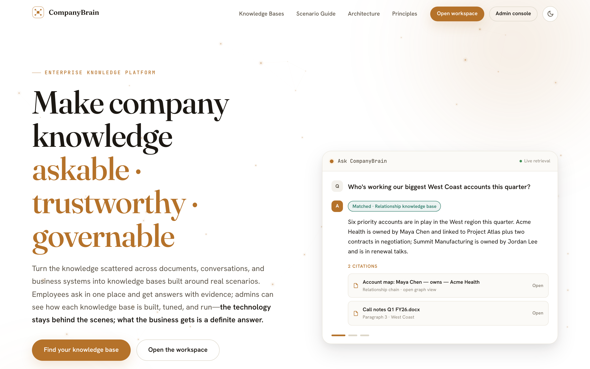
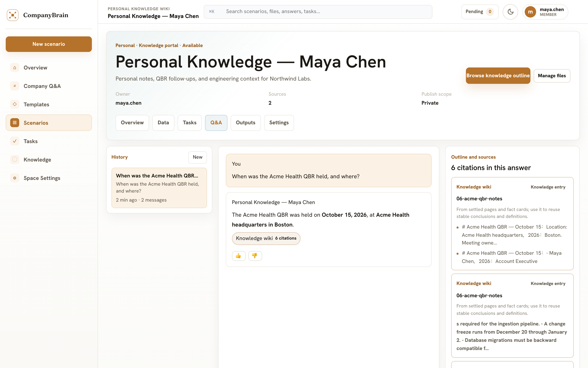
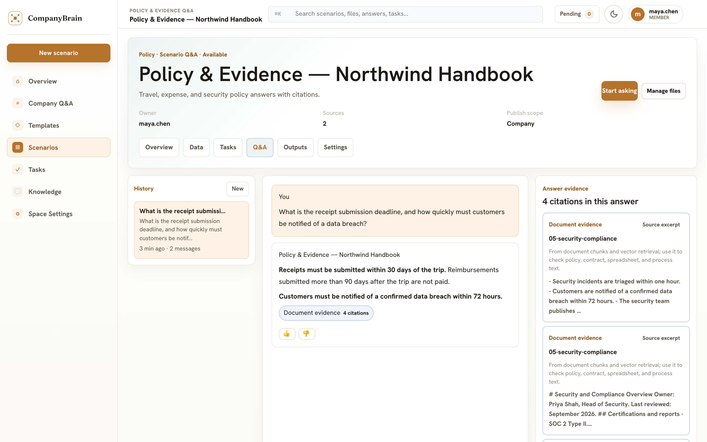
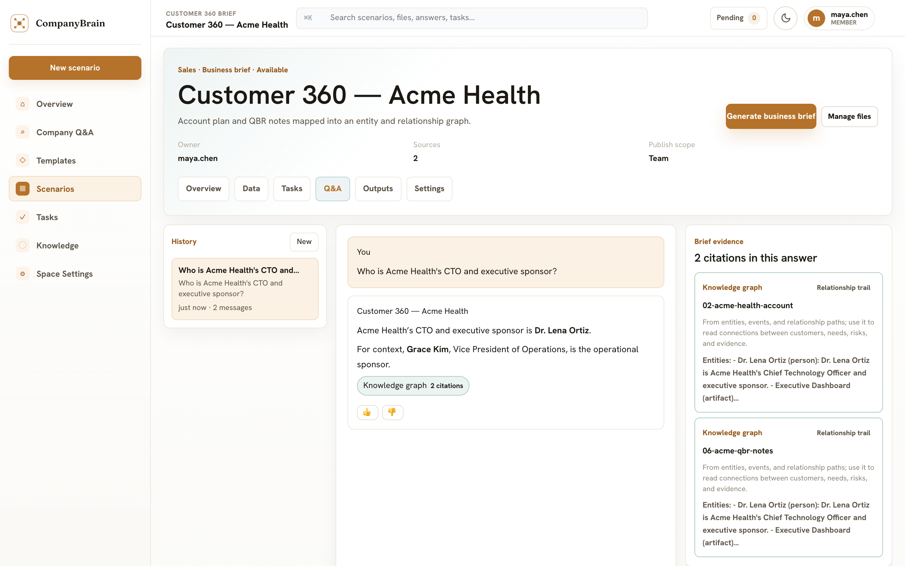
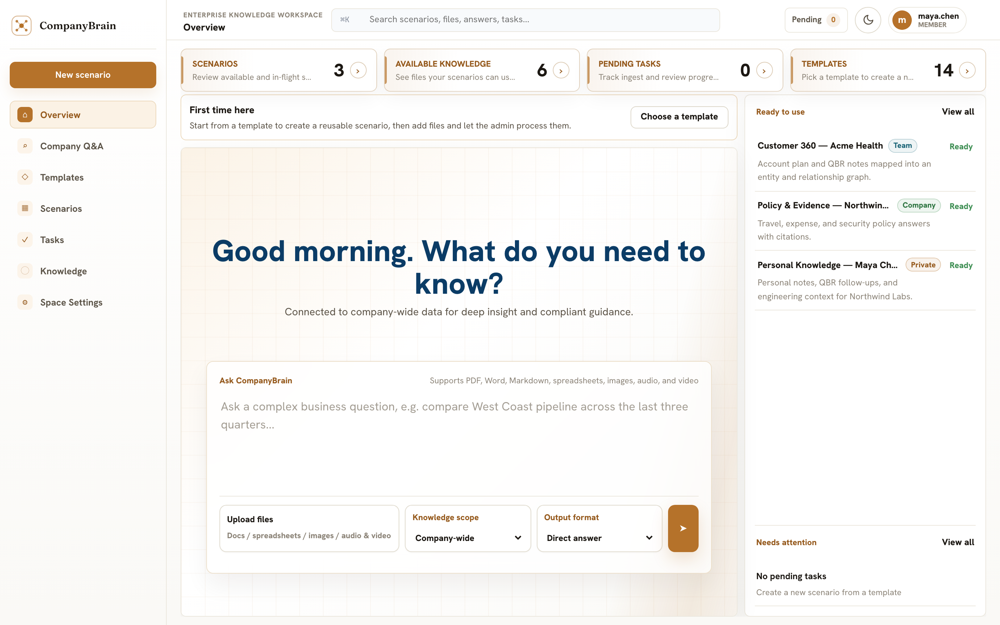
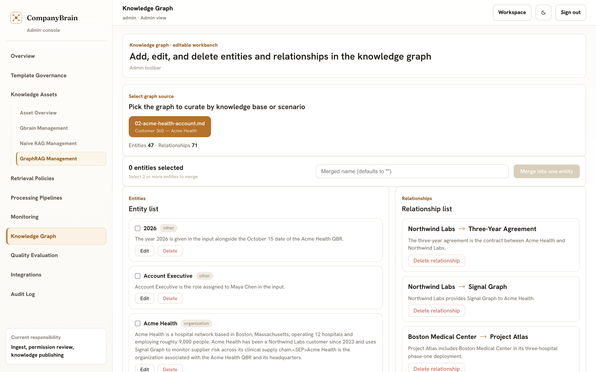
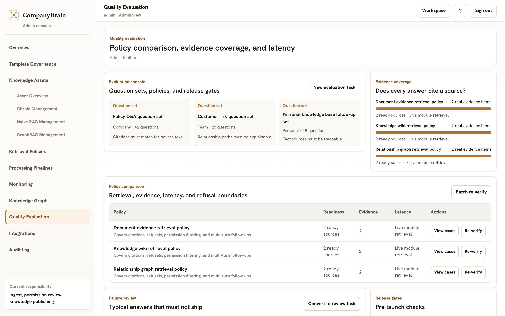
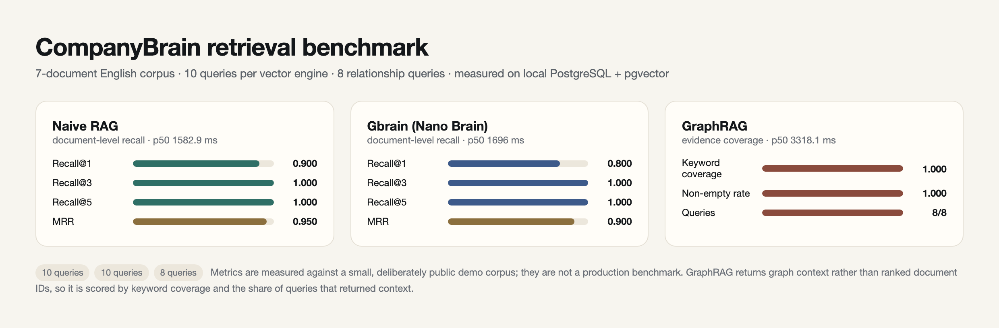
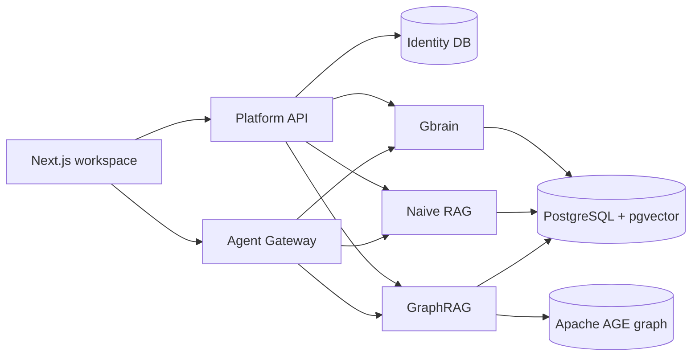

# CompanyBrain

**One workspace, three retrieval engines.** CompanyBrain is a local-first enterprise knowledge
platform. Upload company material once, then choose the engine that fits the question: document
evidence, relationship graphs, or a page-based knowledge brain. Every answer comes with citations.



## Three engines, one workspace

| Engine | What it is good at | How it retrieves |
| --- | --- | --- |
| **Naive RAG** | Policies, contracts, runbooks, evidence-heavy Q&A | Chunking + pgvector embeddings + keyword search, fused ranking, table lookup |
| **GraphRAG** | Customers, suppliers, projects, risk paths, multi-hop questions | LightRAG entity/relationship extraction stored in PostgreSQL + Apache AGE |
| **Gbrain (Nano Brain)** | Personal notes, team handbooks, research pages, facts and links | Markdown pages → chunks → embeddings + keyword index, fused with RRF; facts, links, and dream maintenance |

Each engine keeps its own upload, processing, retrieval, and maintenance path. The platform only
provides identity, routing, and the workspace on top.

## See it in action

| Gbrain answer | Naive RAG answer | GraphRAG answer |
| --- | --- | --- |
|  |  |  |

The product scenarios, admin console, and evaluation loop share the same workspace:

| Workspace | Graph curation | Quality evaluation |
| --- | --- | --- |
|  |  |  |

## Benchmark



| Engine | Queries | Recall@1 | Recall@5 | MRR | p50 latency |
| --- | --- | --- | --- | --- | --- |
| Naive RAG | 10 | 0.900 | 1.000 | 0.950 | 1,583 ms |
| Gbrain (Nano Brain) | 10 | 0.800 | 1.000 | 0.900 | 1,696 ms |
| GraphRAG | 8 | — | — | keyword coverage 1.000 | 3,318 ms |

GraphRAG returns graph context rather than ranked document IDs; all 8 relationship queries returned
non-empty context.

The benchmark is reproducible from the repository: seven English documents, ten queries per vector
engine, and eight relationship queries. See [docs/BENCHMARKS.md](docs/BENCHMARKS.md) for the corpus,
metrics, and commands.

## Architecture



- One PostgreSQL instance, five databases: identity, Gbrain, Naive RAG, GraphRAG, agent checkpoints.
- The platform API never reads module tables directly; it calls each module's HTTP API with an
  internal token.
- The agent gateway orchestrates module MCP servers instead of implementing retrieval itself.

## Quick start

Prerequisites: Bun, Node.js 20+, uv, PostgreSQL 17 with pgvector, and Apache AGE for GraphRAG.

```bash
cp .env.example .env        # add model, embedding, rerank, and database credentials
bun install
uv sync --project modules/traditional-rag
uv sync --project modules/graph-rag

bun run postgres:dev        # macOS helper; on Linux start the systemd unit
bun run db:init
bun run admin:create
bun run dev:all
```

Open `http://localhost:3000` and sign in with the admin account from `.env`.

Full instructions, including Linux, systemd, and production notes:
[docs/DEPLOYMENT.md](docs/DEPLOYMENT.md).

## Demo dataset

The project screenshots and benchmark use a reproducible English demo universe (Northwind Labs,
a fictional San Francisco B2B SaaS company):

```bash
./scripts/reset-demo-data.sh --yes    # drop the five demo databases and local platform store
bun run db:init
bun run admin:create
bun run dev:all             # keep running
bun run demo:seed           # ingest 7 documents + create 3 product scenarios
bun run demo:eval           # benchmark the three engines
bun run demo:chart          # render the benchmark chart
bun run demo:assets         # capture the screenshots used in this README
```

## Multimodal status

Images are supported as **input**, not yet as **evidence returned to the user**:

- A standalone image upload is described by the configured vision model and the description is
  ingested as searchable text.
- PDF figures parsed by MinerU are extracted to local storage and recorded in document metadata;
  the search API returns their paths, but there is no authenticated image endpoint or thumbnail UI
  yet.
- Audio and video can be transcribed when an OpenAI-compatible transcription endpoint is configured.

Returning the image itself (citation thumbnails and an authenticated image endpoint) is on the
roadmap. See [docs/DEPLOYMENT.md](docs/DEPLOYMENT.md) for the current multimodal configuration.

## Repository layout

```txt
apps/
  api/                 Platform API: identity, routing, module dispatch
  web/                 Next.js workspace and admin console
  agent-gateway/       Agent conversations, SSE, MCP tool orchestration
modules/
  nano-brain/          Gbrain: pages, chunks, facts, links, dream maintenance
  traditional-rag/     Naive RAG: parsing, chunking, hybrid retrieval, tables
  graph-rag/           GraphRAG: LightRAG entities and relationships on Apache AGE
packages/
  contracts/           Shared types
  gateway/             Module registry and HTTP dispatch
  identity/            Users, sessions, bearer tokens
  platform/            Templates, demo data, governance helpers
scripts/               Database bootstrap, demo seeding, evaluation, deployment
eval/                  English corpus, golden query sets, retrieval harness
docs/                  Architecture, deployment, API, and benchmark documentation
```

## Documentation

- [Deployment and operations](docs/DEPLOYMENT.md)
- [Benchmarks](docs/BENCHMARKS.md)
- [Architecture](docs/ARCHITECTURE.md)
- [Service boundaries](docs/SERVICE_BOUNDARIES.md)
- [Platform API](docs/API.md)
- [中文 README](README.zh-CN.md)

## License

CompanyBrain is proprietary software. All rights reserved.
